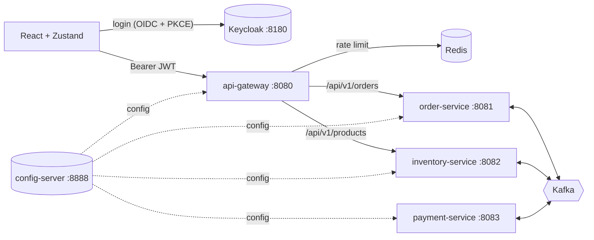

# ShopStream - event-driven e-commerce (enterprise-style reference project)

Java 25 + Spring Boot 4 microservices that talk through **Apache Kafka**, behind a **Spring Cloud Gateway**, secured by **Keycloak**,
configured by **Spring Cloud Config**, observable with **Prometheus / Grafana / Jaeger**, with a **React + TypeScript + Zustand** frontend.
Everything is free and open source and runs locally.


More diagrams (saga sequence, data ownership, quality attributes): [`docs/architecture.md`](docs/architecture.md). Decisions: [`docs/adr`](docs/adr). Operations: [`docs/runbook.md`](docs/runbook.md).

## Enterprise standards covered
| Area | What is implemented |
|---|---|
| **Consistency** | Choreography saga with compensation, transactional outbox, idempotent consumers, idempotent Kafka producer, `Idempotency-Key` on checkout |
| **Resilience** | Circuit breakers + timeouts, GET retries, exponential consumer back-off, dead-letter topics, graceful shutdown, liveness/readiness probes, outbox housekeeping |
| **Security** | OIDC + PKCE, JWT validated at the gateway, identity headers rebuilt from the token, per-user rate limiting, security headers, no secrets in git, non-root containers, NetworkPolicies, image/dependency scanning, CodeQL, Dependabot |
| **API quality** | Versioned routes (`/api/v1`), RFC 9457 Problem Details, bean validation, OpenAPI (Swagger UI on order/inventory), server-side pricing |
| **Observability** | Prometheus metrics + alert rules, Grafana dashboard, distributed tracing across HTTP **and Kafka** (OpenTelemetry -> Jaeger), JSON logs with trace ids in containers, outbox-backlog gauge |
| **Config** | Central config server (Git in production), live refresh, per-profile files, Flyway migrations |
| **Testing** | Unit tests, Testcontainers integration test (real Kafka + PostgreSQL), frontend store tests, ESLint, JaCoCo coverage reports |
| **Delivery** | GitHub Actions (build, test, scan, build+push images), Kustomize manifests (HPA, PDB, NetworkPolicy, Ingress), multi-stage Dockerfile |

## Ports
| URL | What |
|---|---|
| http://localhost:5173 | React app (redirects to Keycloak) |
| http://localhost:8080 | API gateway: the only business entry point |
| http://localhost:8180 | Keycloak (admin / admin) |
| http://localhost:8090 | Kafka UI |
| http://localhost:16686 | Jaeger traces |
| http://localhost:9090 | Prometheus (metrics and alert rules) |
| http://localhost:3000 | Grafana (admin / admin, dashboard "ShopStream overview") |
| 8081 / 8082 / 8083 | order / inventory / payment (internal, call them via the gateway) |
| 9080-9083 | management ports (actuator, Prometheus): internal only |
| 8888 | config-server (basic auth `config` / `config-secret`) |

## Run it locally
```bash
cp .env.example .env                        # optional: change the dev passwords
docker compose up -d                        # PostgreSQL, Kafka, Redis, Keycloak, Jaeger, Prometheus, Grafana, Kafka UI
mvn clean install -DskipTests               # REQUIRED once: installs shop-parent + shop-common into your local Maven repo (needs Java 25, Maven 3.9)
# mvn clean verify                          # optional: also runs unit + integration tests (needs Docker running)
cd config-server     && mvn spring-boot:run     # 1st
cd order-service     && mvn spring-boot:run     # then these three, one terminal each
cd inventory-service && mvn spring-boot:run
cd payment-service   && mvn spring-boot:run
cd api-gateway       && mvn spring-boot:run     # last
cd frontend && npm install && npm run dev       # http://localhost:5173
```
Run everything in containers instead: `docker compose --profile apps up --build` (only the gateway and Keycloak are published).

**Demo users:** `alice` / `alice123` (customer), `admin-user` / `admin123` (admin). You can also self-register in Keycloak.

## Try the scenarios
| Do this | Result |
|---|---|
| Order a keyboard | PENDING -> AWAITING_PAYMENT -> **CONFIRMED** |
| Order the Developer Laptop ($1,499) | payment declined -> **CANCELLED**, stock released |
| Order 4 laptop stands (3 in stock) | **REJECTED** by inventory |
| Click "Place order" many times quickly | HTTP 429 from the gateway rate limiter |
| Stop `inventory-service`, reload the shop | 503 Problem Details from the circuit-breaker fallback |
| Open Jaeger, search service `api-gateway` | one trace: gateway -> order -> Kafka -> inventory -> payment |

**Change config live:** edit `limit: 5000.00` in `config-repo/payment-service.yml`, run
`curl -X POST http://localhost:9083/actuator/refresh`, order the laptop again: the payment now succeeds. No restart.

## How the pieces fit
- **Gateway** (`api-gateway`): validates the JWT, strips and rebuilds `X-User-*` headers, rate-limits per user in Redis, applies circuit breakers and security headers. Routes live in `config-repo/api-gateway.yml` **and** `api-gateway-docker.yml` (Spring replaces a whole list from a profile file, so edit both together).
- **Config** (`config-server`): serves `config-repo/`. Services keep only their name, the config URL and DB credentials (read from environment variables) in their own `application.yml`.
- **Events** (`shop-common`): `Outbox`, `OutboxRelay`, `ProcessedEvents`, topics, dead-letter handling, metrics.

## Deploy to Kubernetes
`kubectl apply -k deploy/k8s` after: creating the `shopstream-secrets` Secret (see `deploy/k8s/secret.example.yaml`), setting your image registry in `kustomization.yaml`, and providing
the infrastructure as Services named `postgres`, `kafka` (port 29092), `redis`, `keycloak` (8080) and `jaeger` (for example from Helm charts or managed services). The manifests reuse the `docker` config profile for these hostnames.

## Production checklist (not included, needs your environment)
- Real PostgreSQL / Kafka / Redis (managed or operators) with backups, TLS and authentication; Keycloak behind HTTPS with a production database
- Config repo in Git, secrets in Vault / external-secrets, TLS ingress, WAF
- Pin the Keycloak, Jaeger and Grafana image versions; commit `package-lock.json` and switch CI to `npm ci`
- Alertmanager (the alert rules exist in Prometheus), log aggregation, SLOs
- Contract tests / schema registry for event evolution; load tests; mTLS or a service mesh between services
