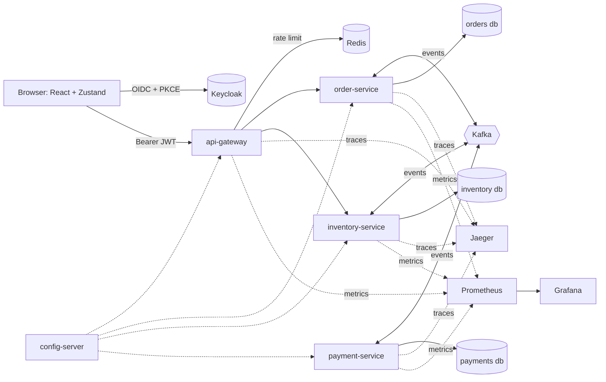
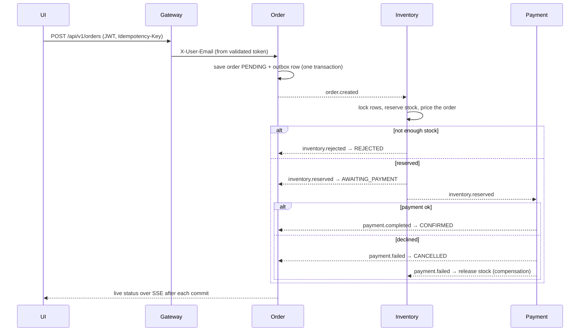

# Architecture

## Containers

## Place-order saga (choreography)

## Data ownership
| Service | Owns | Publishes | Consumes |
|---|---|---|---|
| order-service | orders, order_items, idempotency_keys | order.created | inventory.reserved/rejected, payment.completed/failed |
| inventory-service | products, reservations | inventory.reserved/rejected | order.created, payment.failed |
| payment-service | payments | payment.completed/failed | inventory.reserved |

No service reads another service's database. Prices are decided server-side by inventory-service.

## Quality attributes
| Attribute | How it is addressed |
|---|---|
| Consistency | Saga with compensation; transactional outbox; idempotent consumers; idempotent producer |
| Availability | Stateless services, graceful shutdown, readiness/liveness probes, retries with back-off, dead-letter topics, circuit breakers |
| Security | OIDC/PKCE, JWT validated at the gateway, identity headers rebuilt from the token, network policies, no secrets in git, non-root containers, scanned images |
| Observability | Prometheus metrics + alerts, Grafana dashboard, distributed traces across HTTP and Kafka, structured JSON logs in containers |
| Operability | Central config with live refresh, Flyway migrations, Kubernetes manifests with HPA and PDB |
| Testability | Unit tests, Testcontainers integration test (real Kafka + PostgreSQL), frontend store tests, CI quality gates |
